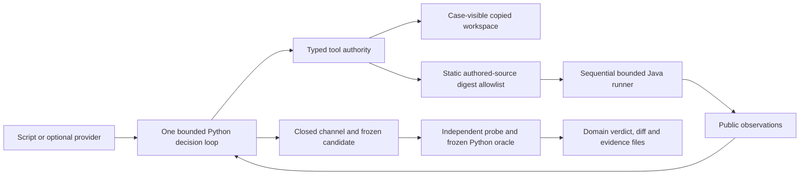

# Architecture and tradeoffs

The original contribution is a small Java semantic-defect suite with negative
controls: a plausible patch can pass public checks while an independent oracle
rejects its final inventory, order, audit or pagination state. The Python loop
connects observed failures to a bounded edit and produces a diff plus evidence.
It is a standalone library demonstration, with no agent framework, dependency
installation, web application or database.

The acting provider receives the issue, contract, four visible file names and
typed tool feedback. It cannot request arbitrary commands, read evaluation
files or change probes. Exact preimage hashes and one-match edits protect
integrity. Reproduction is required before editing, and a current passing
public check is required before the actor finishes. Every transition and tool
decision is retained. Completed and rejected runs use separate directories.

`issue_to_patch/` contains the accepted M2 runtime. `fixtures/` contains nine
authored tasks. `evaluation/evaluator.py` and protected probes compare typed
domain values against independently authored frozen expectations. Trust checks
bind 114 files and per-case candidate digests. The small static allowlist grants
execution to both correct and incorrect authored candidates; correctness comes
from the domain oracle. Novel patches are retained as proposals and trigger no
post-edit process execution. This policy deliberately excludes arbitrary code.

The runner starts one owned process at a time using argument lists, fresh build
directories and restricted environment variables. Java 17 compilation disables
annotation processing. Process time, heap and pipe output are bounded. Timeout,
overflow and cancellation kill and reap the owned child. No process-tree or
hostile-code isolation is claimed. A repository copy, digest allowlist and
subprocess are insufficient to contain hostile same-user code.

The default provider is a conditional authored script. Its V01 first candidate
fails a real public check; the second candidate corrects that regression.
Optional Ollama uses native nonstreaming `/api/chat` structured output and
strict local action validation. It accepts only literal loopback HTTP origins,
with explicit opt-in and model name, and has no proxy discovery, redirect,
retry, fallback, installation or download behavior. Local HTTP doubles validate
the boundary. Actual server/model compatibility, model digest, prompt-hash
capture and live inference quality remain unverified. Loopback addressing does
not prove inference is local: a separately provisioned server must be configured
with `OLLAMA_NO_CLOUD=1` before any separately authorized live use.

The M3 host harness in `evaluation/development.py` leaves the accepted runtime
and frozen inputs unchanged. Both comparison modes delegate to the same
development script with the same budgets and first six tool actions. Reports
hash their common semantic context, first candidate and action prefix. Only
`remaining.wall_seconds`, which is clock telemetry, is excluded from the
context comparison; the common wall-time limit remains 120 seconds.

One-candidate mode stops honestly when its first public check fails. The actor
report remains ABSTAINED. After the channel closes, a separate host evaluation
records the frozen candidate's domain verdict in `baseline-evaluation.json`.
Feedback mode may revise. Passing-before assertions that fail afterward count
as regressions; an infrastructure failure is not a zero-regression result.
All three development tasks stay in the denominator. There are no held-out
scripts, and M3 does not score held-out proposals.

Three V01 repetitions measure observed timing range and median for one authored
workflow. They do not measure stochastic model variance. Candidate calibration,
development ablation, runtime repetitions and future live evaluation have
separate evidence labels. Live held-out solve rate is null. JSON receipts retain
commands, source/oracle digests, assertions, attempts, patch sizes and terminal
reasons. Unknown token usage remains null; no token estimate or price is invented.

Python 3.11 and JDK 17 are the only runtime dependencies. In-memory,
single-threaded state keeps the examples inspectable and avoids implying
database or distributed transaction guarantees. The same-author public split
tests verification plumbing, not model generalization or production repair
quality. Source secrecy is not the protection: evaluator access is excluded
from tool authority, while public readers can inspect every label.

LF checkout rules preserve the accepted digest bytes on Windows and Linux.
The CI workflow uses exact official action SHAs and standard runners in a
sequential matrix, read-only permissions, no caches, secrets, uploads or live
provider. Its configuration is authored and source-checked; hosted execution
requires separately authorized publication and remains unexecuted.
